  

I'm a Computer Engineering student at Mudanya University. I work on the layer between AI models and the real world: harnesses, hooks, MCP servers and the verification gates that keep an agent honest. My own workflow runs on a second brain: an Obsidian vault with hooks, memory and an assistant that remembers across sessions.

  

<b>The projects behind each layer</b>

 

| Layer | Project | |
|:--|:--|:--|
| **Agents** | **Munin** · *private, in progress* | Desktop assistant on the Linux screen edge (Wayland layer-shell + KWin), wired to my vault |
| | [**Agentic-Research**](https://github.com/berenrusatci/Agentic-Research) | Multi-role research pipeline; raw answers kept verbatim, then verified against the codebase |
| **ML** | [**AI-KneeRisk**](https://github.com/berenrusatci/AI-KneeRisk-Sporcularda-Diz-Dejenerasyonu-ve-Osteoartrit-Risk-Tahmininde-Kullan-labilecek-3D-MRI) | TÜBİTAK 2209-A: 3D / 2.5D MRI model for knee osteoarthritis risk, with a no-install Windows demo |
| **Software** | [**Co-Pronoia**](https://github.com/berenrusatci/Co-Pronoia) | Multi-user tree planner; every change is an authored commit, conflicts branch instead of overwriting |
| | **Smart Shuttle** · *team of 7, private* | Live trip tracking, dynamic stop-skipping, RBAC and tenant scoping, KVKK-compliant GPS data |
| **Systems** | [**zapret-tr-config**](https://github.com/berenrusatci/zapret-tr-config) | One-command DPI-bypass setup for Arch and Debian |
| **Hardware** | [**kicad-pcb-agent**](https://github.com/berenrusatci/kicad-pcb-agent) | Skills and verification tools for an LLM-driven KiCad PCB design agent |

#### How I work

- **Measure, don't claim.** A check that scanned nothing must not report "all clear".
- **AI is part of the workflow, not a side tool.** I delegate code to agents and keep the architecture.
- **Least privilege by default.** Agents get the narrowest tools that do the job.

  

  <code>C</code> · <code>C++</code> · <code>Python</code> · <code>TypeScript</code> · <code>Go</code> · <code>C#</code> · <code>Java</code> 
  <code>Claude Agent SDK</code> · <code>MCP</code> · <code>PyTorch</code> · <code>Qt</code> · <code>Docker</code> · <code>KiCad</code> · <code>Arch / Wayland</code>

   
  <a href="https://www.linkedin.com/in/beren-rusat%C3%A7%C4%B1">LinkedIn</a>

